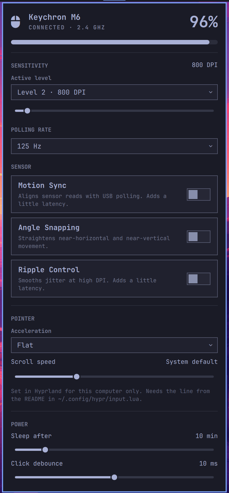

# omarchy-keychron-m6

An [Omarchy](https://omarchy.org/) bar widget for the Keychron M6 mouse. The
bar shows the battery level, and the panel changes DPI, polling rate, sensor
options, buttons, pointer acceleration, and scroll speed.

<p align="center">
  
</p>

The widget supports only the PixArt 3311 version of the Keychron M6, such as
the M6 Ultra Silent (M6S-A72). On the USB-C cable, this version has the USB ID
`3434:d064`. The 8K versions of the M6 use other sensors and other USB IDs, and
the widget ignores them.

## Requirements

- Omarchy with the Quickshell shell (`omarchy-shell`)
- Python 3
- A Keychron M6 with the PixArt 3311 sensor (USB ID `3434:d064`)

## Install the widget

1. Add the plugin and put the widget in the bar:

   ```bash
   omarchy plugin add https://github.com/prasetiady/omarchy-keychron-m6.git --enable
   ```

2. Install the udev rule, so your user can open the M6's settings interface.
   This step needs `sudo`:

   ```bash
   cd ~/.config/omarchy/plugins/keychron-m6.panel
   sudo install -m 644 70-keychron-m6.rules /etc/udev/rules.d/
   sudo udevadm control --reload && sudo udevadm trigger --subsystem-match=hidraw
   ```

   The rule opens only the interface that carries the mouse's settings, on the
   M6 and on the Link-KM receiver. Their keyboard and pointer interfaces, and
   every other Keychron device, stay root-only. Until the rule is installed,
   the panel shows "No access: install the udev rule".

3. To let the panel set pointer acceleration and scroll speed, add this line
   to the end of `~/.config/hypr/input.lua`:

   ```lua
   dofile(os.getenv("HOME") .. "/.config/omarchy/plugins/keychron-m6.panel/hypr/pointer.lua")
   ```

   Hyprland reloads the file when you save it, and runs the line every time it
   starts, so both settings survive a reboot. Without this line, the
   **Acceleration** and **Scroll speed** settings in the panel have no effect.

To show only the mouse icon in the bar, right-click it. Right-click again to
bring the battery percentage back.

## What the panel controls

Most settings are stored in the mouse's onboard memory. They stay after a
reboot and apply on any computer you use the mouse with. Pointer acceleration
and scroll speed are the exceptions. They are Hyprland settings for this
computer only.

The table lists the settings in the order the panel shows them.

| Setting | Values |
|---|---|
| Battery | Percentage and charging state. The bar icon turns the urgent color at or below the low-battery threshold (15% by default). |
| Active DPI level | One of five levels |
| DPI of the active level | 50 to 12000, in steps of 50 |
| Pointer acceleration | System default, Flat, or Adaptive |
| Scroll speed | 0.1× to 3.0× the normal speed, in steps of 0.1. Applies to both wheels. |
| Thumb wheel speed | 1× to 10× the default horizontal scroll per notch. Stored on the mouse. |
| Buttons | Middle, right, back, forward, wheel tilt left and right, wheel up and down, and thumb wheel left and right. Left click can't be remapped, so a mistake can't lock you out. |
| Polling rate | 125, 500, or 1000 Hz |
| Motion Sync, Angle Snapping, Ripple Control | On or off |
| Sleep timer | 1 to 60 minutes in the panel |
| Click debounce | 0 to 20 ms in the panel |
| Factory reset | Restores the mouse's defaults. Click the button twice to confirm. |

The thumb wheel speed is stored as the mapping of the two thumb wheel buttons,
so it works on every computer. Hyprland's scroll speed multiplies it: with a
scroll speed of 0.5× and a thumb wheel speed of 4×, the thumb wheel scrolls at
2× while the main wheel scrolls at 0.5×. Remapping the thumb wheel under
**Buttons** replaces the thumb wheel speed.

Scrolling with the pointer over a slider scrolls the panel. To change a
slider, drag it or click its track.

## Connections

The widget finds the mouse on any of its three connections. When the cable
and the receiver are both connected, the widget uses the cable, because only
the cable reports charging reliably. The widget asks each Keychron receiver
which mouse it is paired with, and uses the receiver only when that mouse is
the PixArt 3311 M6. Bluetooth is not tested yet.

| Connection | Bar and panel | Changing settings |
|---|---|---|
| 2.4 GHz Keychron Link receiver, paired with the M6 | Battery and all settings | Yes |
| USB-C cable | Battery, charging state, and all settings | Yes |
| Bluetooth | Battery, read from UPower | Only if the Bluetooth HID map exposes the vendor page `0xFFC1` |

When the mouse sleeps behind the receiver, the panel shows "Asleep: move the
mouse" and keeps the last values it read.

## Command reference

`keychron-ctl` is in the plugin folder. The panel runs it for every read and
write, and you can run it yourself:

```bash
cd ~/.config/omarchy/plugins/keychron-m6.panel
./keychron-ctl status
./keychron-ctl set rate 1000
./keychron-ctl buttons set 9 shortcut super+shift+f13
```

| Command | What it does |
|---|---|
| `keychron-ctl status` | Prints the connection, the battery, and every setting as `key=value` lines |
| `keychron-ctl set <setting> <value>` | Writes one setting, then reads it back from the mouse |
| `keychron-ctl buttons get` | Prints the button mappings as JSON |
| `keychron-ctl buttons set <index> <action> [<shortcut>]` | Remaps one button |
| `keychron-ctl reset` | Restores the mouse's factory defaults and clears the acceleration and scroll speed settings |
| `keychron-ctl probe` | Prints the raw replies from each Keychron device. Attach the output to a bug report. |

Settings for `set`:

| Setting | Values |
|---|---|
| `dpi-active` | `0` to `4`, the index of the active level |
| `dpi` | The DPI of the active level, from `50` to `12000`. Rounded to a step of 50. |
| `dpi-levels` | Five comma-separated DPI values, such as `400,800,1600,3200,5000` |
| `rate` | `125`, `500`, or `1000` |
| `motion-sync`, `angle-snap`, `ripple`, `scroll-reverse` | `on` or `off` |
| `debounce` | `0` to `30` ms |
| `sleep` | `1` to `240` minutes |
| `accel` | `flat`, `adaptive`, or `default` |
| `scroll-speed` | `0.1` to `3.0`, or `default` |
| `hscroll` | `1` to `10`, the thumb wheel's scroll step per notch. `1` restores the factory mapping. |

Button indexes for `buttons set`: `1` middle, `2` right, `3` back, `4`
forward, `9` wheel tilt left, `8` wheel tilt right, `14` wheel up, `13` wheel
down, `11` thumb wheel left, and `10` thumb wheel right.

Button actions: `default`, `disable`, `left`, `right`, `middle`, `back`,
`forward`, `scroll-up`, `scroll-down`, `scroll-left`, `scroll-right`,
`volume-up`, `volume-down`, `mute`, `play-pause`, `previous`, `next`, `stop`,
`dpi-cycle`, `dpi-up`, `dpi-down`, and `shortcut`. A `shortcut` takes up to
four modifiers (`ctrl`, `shift`, `alt`, `super`) and one key, such as
`super+shift+f13`.

Exit codes: `0` on success, `1` for an invalid value, a write the mouse
refuses, or a value the mouse doesn't store, `2` for an unknown command, `3`
when the udev rule is missing, and `4` when the mouse doesn't answer.

## How it works

`keychron-ctl` talks to the mouse over its vendor HID channel, usage page
`0xFFC1`. It sends commands on output reports `0xB3` and `0xB5` and reads
replies on input reports `0xB4` and `0xB6`. The receiver forwards the same
commands to the mouse, so the receiver and the cable share one code path.
After every write, `keychron-ctl` reads the setting back, so the panel shows
what the mouse stored.

Pointer acceleration and scroll speed are stored in
`~/.local/state/keychron-m6/` as plain text. `hypr/pointer.lua` validates each
value before it calls `hl.device` with `accel_profile` and `scroll_factor`.

## Work on the widget

To run the widget from a clone instead of the installed copy:

```bash
ln -s "$PWD" ~/.config/omarchy/plugins/keychron-m6.panel
omarchy plugin enable keychron-m6.panel
```

The shell doesn't watch a symlinked plugin folder. After you edit `Panel.qml`,
`Model.js`, or `WheelGuard.qml`, run `omarchy restart shell` to load the
change.

To run the tests:

```bash
tests/run
```

The tests use a fake sysfs tree and a fake HID transport, plus replies captured
from an M6S-A72. They don't need the mouse.

## Uninstall the widget

Removing the plugin doesn't undo the settings stored on the mouse, so reset
the mouse first if you remapped buttons.

1. Reset the mouse:

   ```bash
   ~/.config/omarchy/plugins/keychron-m6.panel/keychron-ctl reset
   ```

2. Remove the plugin:

   ```bash
   omarchy plugin remove keychron-m6.panel
   ```

3. Delete the `dofile` line from `~/.config/hypr/input.lua`, and delete the
   saved pointer settings:

   ```bash
   rm -r ~/.local/state/keychron-m6
   ```

4. Remove the udev rule:

   ```bash
   sudo rm /etc/udev/rules.d/70-keychron-m6.rules
   ```

## Credits

The protocol details come from Keychron's own client code, with help from
these projects:

- [keychron-battery-dkms](https://github.com/csutcliff/keychron-battery-dkms)
- [chron-tui](https://github.com/kubastick/chron-tui)
- [Darmoshark M3 protocol notes](https://github.com/Barba2k2/darmoshark-m3-configurator/blob/main/PROTOCOL.md)
